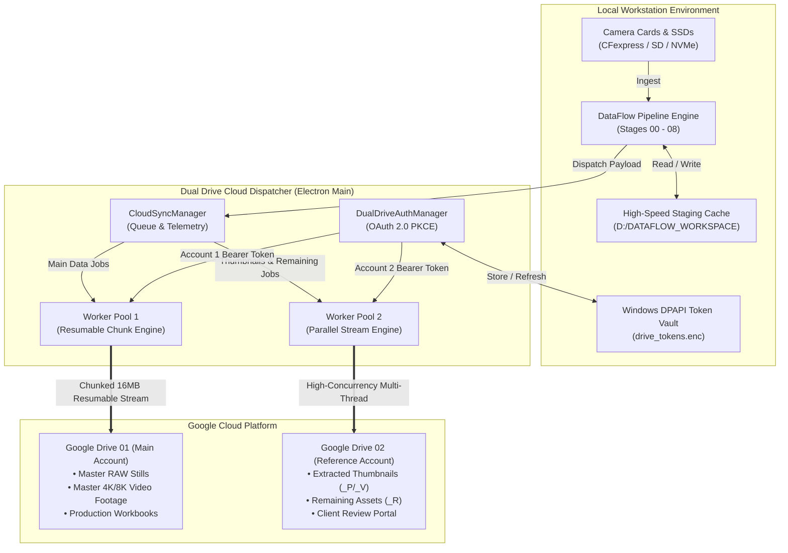
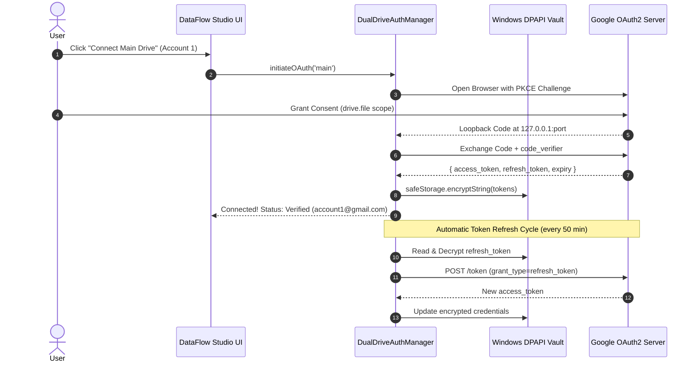
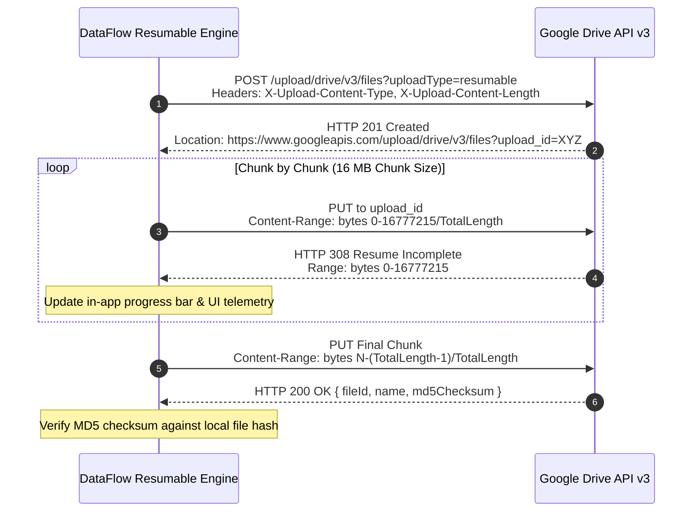

# Blueprint 07 — Dual Google Drive Enterprise Integration Architecture

> **DataFlow Studio / MediaFlow Studio Engineering Specification**  
> *Deterministic, Zero-Data-Loss Multi-Cloud Pipeline Across Dual Google Drive Accounts*

---

## ⚡ Quick Summary & Answers (FAQ)

### 1. How Does It Work in Short?
* **Google Drive 01 ("Main Drive")**:
  - Stores all the heavy **Main Data to merge**: camera RAW files (`.CR3`, `.ARW`), master 4K/8K video footage (`.MOV`, `.MP4`), and synced sequence subfolders.
* **Google Drive 02 ("Reference Drive")**:
  - Stores the **Remaining folders** (`_R` unselected/extra photos) and **Thumbnails** (`_P` photo previews and `_V` video poster frames).
* **Automated Cloud Shifting**:
  - Whenever thumbnails or remaining folders exist on Drive 01 (or local staging), DataFlow Studio automatically identifies them and **shifts/transfers them directly into Google Drive 02**.
  - Drive 01 remains clean with only the master deliverable data.

```
                    ┌──────────────────────────────────────────┐
                    │           DATAFLOW / CINEFLOW            │
                    └────────────────────┬─────────────────────┘
                                         │
             ┌───────────────────────────┴───────────────────────────┐
             ▼                                                       ▼
  ┌──────────────────────┐                               ┌──────────────────────┐
  │    GOOGLE DRIVE 1    │                               │    GOOGLE DRIVE 2    │
  │     (MAIN DRIVE)     │                               │  (REFERENCE DRIVE)   │
  ├──────────────────────┤                               ├──────────────────────┤
  │ • Main Data to merge │                               │ • Remaining Folders  │
  │ • Master RAW Photos  │ ───(Auto-Shift Thumbnails)───►│   (_R Tagged Photos) │
  │ • Master 4K/8K Video │ ───(Auto-Shift Remaining)────►│ • Thumbnails (_P/_V) │
  │ • Synced Sequences   │                               │ • Client Selections  │
  │ • Master Ingest Rep  │                               │ • Review Catalogs    │
  └──────────────────────┘                               └──────────────────────┘
```

### 2. Will It Be Free?
**YES, 100% FREE!**
1. **Google Drive API is Free**: Google does **not charge** for API requests or Google Cloud developer projects. You get unlimited free standard usage without recurring API fees.
2. **Dual Free Storage (30 GB Combined Out-of-the-Box)**:
   - Every standard Google account comes with **15 GB free storage**.
   - Because this architecture connects **two separate accounts**, you get **15 GB + 15 GB = 30 GB free storage**.
   - You only pay Google if you voluntarily upgrade your storage via Google One (e.g. 100 GB or 2 TB plans) for large multi-terabyte wedding archives.
3. **Zero Third-Party Middleman Fees**:
   - The app communicates directly between your machine and Google's official API servers. There are no paid intermediate servers, hosting subscriptions, or third-party fees.

---

## 1. Executive Summary & Vision

### 1.1 The Challenge
Modern high-volume media production turnarounds (weddings, corporate summits, film productions) generate multi-terabyte datasets per shoot across multiple cameras. Currently, **DataFlow Studio** executes its deterministic 9-stage pipeline (PV Separator, Upload Structure, Photo Status Tagger, Remaining Shifter, Event Distributor, Video Transfer Sync, Thumbnail Shifter, DO NOT UPLOAD Isolator, and Report Merger) strictly against local storage media (NVMe, SSDs, SD cards).

To achieve seamless cloud handoff and eliminate tedious manual uploading via web browsers, the entire application workflow must be architected to operate with **Google Drive**, specifically across **two separate, isolated Google Drive accounts / cloud endpoints**.

```
                        ┌──────────────────────────────────────────────────┐
                        │              DATAFLOW STUDIO ENGINE              │
                        │     Local Zero-Data-Loss Processing Pipeline     │
                        └────────────────────────┬─────────────────────────┘
                                                 │
                                                 ▼
                        ┌──────────────────────────────────────────────────┐
                        │          DUAL-DRIVE CLOUD DISPATCH BUS           │
                        │       Intelligent Asset Separation Engine        │
                        └──────────┬────────────────────────────┬──────────┘
                                   │                            │
             [High-Bitrate Masters & RAW Assets]   [Thumbnails, Previews & Reports]
                                   │                            │
                                   ▼                            ▼
                    ┌────────────────────────────┐┌────────────────────────────┐
                    │      GOOGLE DRIVE 01       ││      GOOGLE DRIVE 02       │
                    │       "MAIN DRIVE"         ││     "REFERENCE DRIVE"      │
                    │   Account 1: Master Vault  ││  Account 2: Client & Review│
                    ├────────────────────────────┤├────────────────────────────┤
                    │ • Master RAW Photos (.CR3) ││ • Extracted Photos (_P)    │
                    │ • Master 4K/8K Video (MOV) ││ • Extracted Video Clips(_V)│
                    │ • Synced Sequence Folders  ││ • Remaining Photos (_R)    │
                    │ • Production Archive Stills││ • Event Client Selections  │
                    │ • Master Excel Ingest Rep  ││ • Client Review Spreadsheets│
                    └────────────────────────────┘└────────────────────────────┘
```

---

## 2. The 2-Drive Functional Topology

### 2.1 Why Two Drives?

| Operational Vector | Google Drive 01 ("Main Drive") | Google Drive 02 ("Reference Drive") |
| :--- | :--- | :--- |
| **Primary Account** | Studio Master Ingest Account (e.g., `archive@studio.com`) | Client Delivery / Review Account (e.g., `client-review@studio.com`) |
| **Data Role & Pipeline Function** | **Main Data to Merge**: Holds master RAW photos, master 4K/8K footage, audio syncs, and unified delivery workbooks. | **Remaining Folders & Thumbnails**: Holds all shifted unselected photos (`_R`) and companion thumbnails (`_P` / `_V`). |
| **Auto-Shifting Mechanism** | Any thumbnails or remaining folders currently on Drive 01 are **automatically shifted/routed into Drive 02**. | Acts as the dedicated recipient sink for all shifted previews and extra non-master media. |
| **Cost & Licensing** | **100% Free** via Google Drive API v3 (15 GB free default storage; no API charges). | **100% Free** via Google Drive API v3 (Separate 15 GB free default storage; total 30 GB free). |
| **Typical Size / Shoot**| 500 GB – 5 TB (Upgraded Google One as needed) | 15 GB – 100 GB (Easily fits free / entry-level storage) |
| **Target Audience** | Senior Editors, Colorists, Deep Archive Systems | End-clients, Selection Coordinators, Retouchers |
| **Access Permissions** | Strict internal studio access (zero public links) | Restricted client-facing view/download/comment permissions |
| **Upload Strategy** | Chunked Resumable Upload with sequential priority queues | High-concurrency parallel stream for instant web browser availability |
| **Google Upload Limit**| Consumes 750 GB/day quota on Account 1 | Consumes 750 GB/day quota on Account 2 (**Total: 1.5 TB/day!**) |

### 2.2 Canonical Target Hierarchy on Both Drives

```
GOOGLE DRIVE 01 (MAIN DRIVE - ACCOUNT 1)
└── 📁 [Master_Deliveries]
    └── 📁 {Safar_Or_Event_Name} (e.g., "2026-02-14_ROYAL_WEDDING")
        ├── 📁 Main Data
        │   └── 📁 {Safar_Or_Event_Name}
        │       ├── 📁 2026-02-14_Day01
        │       │   ├── 📁 CAM_A_SONY_A7S3 (RAWs + Synced Audio)
        │       │   ├── 📁 CAM_B_FX6 (Master ProRes Video Clips)
        │       │   └── 📁 CAM_C_CANON_R5 (RAW Photos + Video)
        │       └── 📁 2026-02-15_Day02
        │           ├── 📁 CAM_A_SONY_A7S3
        │           └── 📁 CAM_B_FX6
        └── 📄 INVENTORY_MASTER_DELIVERY_REPORT.xlsx

GOOGLE DRIVE 02 (REFERENCE DRIVE - ACCOUNT 2)
└── 📁 [Client_Portals]
    └── 📁 {Safar_Or_Event_Name} (e.g., "2026-02-14_ROYAL_WEDDING")
        ├── 📁 Thumbnails
        │   └── 📁 {Safar_Or_Event_Name}
        │       ├── 📁 _P_Thumbnails (Lightweight JPEGs for rapid web browsing)
        │       └── 📁 _V_Thumbnails (Poster frames and web-ready video clips)
        ├── 📁 Remaining
        │   └── 📁 {Safar_Or_Event_Name}
        │       ├── 📁 2026-02-14_Day01_Remaining_Photos (_R Tagged)
        │       └── 📁 2026-02-15_Day02_Remaining_Photos (_R Tagged)
        ├── 📁 Event_Selections (Auto-badged by Event Image Shifter)
        └── 📄 CLIENT_SELECTION_CATALOG.xlsx
```

---

## 3. Architectural Approaches: Evaluation & Selection

We evaluate three distinct architectural approaches for integrating Google Drive into DataFlow Studio:

```
┌───────────────────────────────────────────────────────────────────────────────────────────┐
│                               ARCHITECTURAL COMPARISON MATRIX                             │
├─────────────────────────┬───────────────────────────────┬─────────────────────────────────┤
│ Mode 1: Virtual Drive   │ Mode 2: Direct Cloud REST API │ Mode 3: Enterprise Hybrid Cloud │
│ (Google Drive Desktop)  │ (Headless API Integration)    │ (Local Staging + Cloud Daemon)  │
├─────────────────────────┼───────────────────────────────┼─────────────────────────────────┤
│ • Zero code changes to  │ • 100% standalone, no third-  │ • High-speed NVMe staging (zero │
│   binary I/O operations │   party desktop app needed    │   latency on heavy calculations)│
│ • Dependent on Google   │ • Multi-TB video files over   │ • Background streaming daemon to│
│   Drive Desktop software│   network = extreme latency   │   Drive 1 & Drive 2 concurrently│
│ • No custom upload bar  │ • High risk of crash on raw   │ • Best of both worlds: extreme  │
│   or bandwidth limiter  │   image/video parsing         │   speed + full cloud control    │
└─────────────────────────┴───────────────────────────────┴─────────────────────────────────┘
```

### 3.1 Mode 1: Virtual Drive (Google Drive for Desktop Mount)
- **Concept**: Google Drive for Desktop natively mounts Google Accounts as Windows drive letters (e.g. `G:\My Drive` and `H:\My Drive`). It supports up to 4 concurrent Google accounts simultaneously.
- **Workflow**: DataFlow Studio treats `G:\` as Drive 1 and `H:\` as Drive 2. Existing native file copy/move operations work directly on virtual paths.
- **Verdict**: Excellent for low-effort instant setup; however, it lacks in-app progress telemetry, cannot throttle bandwidth, and virtual drive file locks can freeze Electron when syncing multi-gigabyte files.

### 3.2 Mode 2: Direct Cloud-Native REST API (Pure Headless)
- **Concept**: All operations (listing files, creating folders, tagging, moving) occur exclusively over Google Drive API v3 without saving files to local disk.
- **Verdict**: Impractical for multi-terabyte production data. Parsing camera RAW files (`.CR3`, `.ARW`) and extracting 4K video poster frames over an HTTP API introduces massive latency, exhausts daily API call quotas, and fails if internet drops mid-pipeline.

### 3.3 Mode 3: The Enterprise Hybrid Ingestion Engine (RECOMMENDED STANDARD)
- **Concept**: 
  1. **Stage 1 (Local Deterministic Ingest)**: Ingest operators plug in camera cards/SSDs. DataFlow Studio executes all intensive binary parsing, thumbnail extraction, photo/video matching, and spreadsheet generation on a high-speed local NVMe workspace (e.g., `D:\DATAFLOW_WORKSPACE`).
  2. **Stage 2 (Dual Cloud Dispatch Daemon)**: As each pipeline stage completes, the background Cloud Dispatch Engine streams assets asynchronously:
     - All `Main Data/` folders are queued to **Drive 1 (Main Drive)** via Google Drive API v3 Resumable Uploads.
     - All `Thumbnails/`, `Remaining/`, and `Reports` are queued to **Drive 2 (Reference Drive)** in parallel.
  3. **Stage 3 (Cloud Control HUD)**: The user enjoys real-time progress bars, pause/resume controls, retry queues, storage quota meters, and instant shareable link generation directly inside DataFlow Studio.

---

## 4. End-to-End System Architecture

### 4.1 System Topology Diagram



---

## 5. Dual Account Authentication & Security Protocol

### 5.1 OAuth 2.0 PKCE Flow (Zero Client Secrets)
To authenticate two independent Google Accounts securely without embedding static client secrets into client builds:

1. **Local Loopback Listener**: Electron starts an ephemeral local HTTP server on `127.0.0.1:49152..49200`.
2. **PKCE Challenge**: A cryptographically random `code_verifier` (43–128 characters) is generated, and its SHA-256 hash (`code_challenge`) is created.
3. **Account Isolation**:
   - For **Drive 1**: Electron launches Google OAuth with prompt `select_account` and parameter `login_hint` (or clean session).
   - For **Drive 2**: Electron launches Google OAuth within a distinct session partition (`persist:ref_drive_auth`).
4. **Token Exchange**: Electron intercepts the authorization code at `http://127.0.0.1:[port]/oauth2callback`, exchanges it for:
   - `access_token` (Short-lived, 3600 seconds)
   - `refresh_token` (Long-lived, permanent until revoked)
5. **Secure Storage via Windows DPAPI**:
   Tokens are encrypted using Electron's `safeStorage.encryptString()` and saved to `userData/drive_credentials.enc`. Keys are tied to the local Windows user profile and cannot be decrypted if copied to another machine.

### 5.2 Token Refresh Lifecycle



---

## 6. Stage-by-Stage App Pipeline Transformation

Here is how each pipeline stage in DataFlow Studio adapts to support dual Google Drive operations:

```
┌────────────────────────────────────────────────────────────────────────────────────────┐
│                        DATAFLOW STUDIO DUAL-DRIVE STAGE MATRIX                         │
├────────┬──────────────────────┬──────────────────────┬─────────────────────────────────┤
│ Stage  │ Pipeline Stage       │ Local Execution      │ Dual Cloud Destination          │
├────────┼──────────────────────┼──────────────────────┼─────────────────────────────────┤
│ **00** │ **PV Separator**     │ Fast RAW/Video split │ Staged to local NVMe buffer     │
│ **01** │ **Upload Structure** │ Creates local schema │ Mirrored on Drive 1 & Drive 2   │
│ **02** │ **Photo Status Tag** │ _U vs _R Tagging     │ _U -> Drive 1; _R -> Drive 2    │
│ **03** │ **Remaining Shift**  │ Date consolidation   │ Synced to Drive 2 /Remaining/   │
│ **04** │ **Event Image Dist** │ Event badges applied │ Synced to Drive 2 /Events/      │
│ **05** │ **Video Sync Sync**  │ Multi-cam sequence   │ Synced to Drive 1 /Main Data/   │
│ **06** │ **Thumbnail Shift**  │ _P & _V extraction   │ Synced to Drive 2 /Thumbnails/  │
│ **07** │ **DO NOT UPLOAD**    │ Quarantine Isolation │ STRICTLY BLOCKED from both      │
│ **08** │ **Report Merger**    │ Multi-sheet Excel    │ Dual-uploaded to Drive 1 & 2    │
└────────┴──────────────────────┴──────────────────────┴─────────────────────────────────┘
```

### Stage 00 • PV Separator (RAW Ingestion & Split)
- **Local Role**: High-speed memory-mapped scan separating RAW still photos (`.CR3`, `.ARW`, `.NEF`, `.DNG`) from high-bitrate video clips (`.MOV`, `.MP4`, `.ProRes`) and multi-channel audio (`.WAV`).
- **Cloud Action**: Categorizes payload sizes. Allocates video assets and RAW sets for **Drive 1**, while creating lightweight thumbnail generation queues for **Drive 2**.

### Stage 01 • Upload Structure (Folder Hierarchy Generator)
- **Local Role**: Generates standardized folder roots:
  `{BaseDir}/{SafarName}/Main Data/{SafarName}`  
  `{BaseDir}/{SafarName}/Thumbnails/{SafarName}`  
  `{BaseDir}/{SafarName}/Remaining/{SafarName}`
- **Cloud Action**: Creates the corresponding cloud folder hierarchies simultaneously:
  - **On Drive 1**: Checks/creates `Main Data/{SafarName}`.
  - **On Drive 2**: Checks/creates `Thumbnails/{SafarName}` and `Remaining/{SafarName}`.
  - Stores Google Drive Folder IDs in Pipeline Context for direct upload routing without repeated lookup queries.

### Stage 02 • Photo Status Tagger (`_U` & `_R` Renamer)
- **Local Role**: Compares remaining photos against original camera cards. Tags files with suffix `_U` (Used in presentation) and `_R` (Remaining / Unused).
- **Cloud Action**: 
  - Photos tagged `_U` are routed to the **Drive 1 Master Data Tree**.
  - Photos tagged `_R` are scheduled for **Drive 2 Remaining Tree**.

### Stage 03 • Remaining Shifter (Date Consolidation)
- **Local Role**: Consolidates date-level remaining media into clean master dates.
- **Cloud Action**: Directs date-grouped remaining assets to **Drive 2 (Reference Drive)** under `Remaining/{SafarName}/{Date}_Remaining/` so client review teams can browse unselected shots without touching master video storage.

### Stage 04 • Event Image Shifter (Auto Event Badges)
- **Local Role**: Extracts event names and assigns metadata badges.
- **Cloud Action**: Synchronizes client-curated event highlights into a designated `Event_Highlights/` folder on **Drive 2**, enabling instant client link generation.

### Stage 05 • Sync Photo Video (Multi-Camera Sequence Alignment)
- **Local Role**: Matches video clips into corresponding photo subfolders using sequence numbers and camera tokens.
- **Cloud Action**: The synced multi-camera master video files (which typically range from 2 GB to 50 GB per clip) are dispatched exclusively to **Drive 1 (Main Drive)** using the Resumable Upload Engine with SHA-256 checksum validation.

### Stage 06 • Thumbnail Shifter (`_P` & `_V` Isolation)
- **Local Role**: Generates and moves `_P` (photo preview) and `_V` (video poster frame) thumbnail assets.
- **Cloud Action**: Dispatched exclusively to **Drive 2 (Reference Drive)** under `Thumbnails/{SafarName}/`. Because thumbnails are small (200 KB – 2 MB), they use a multi-threaded parallel HTTP upload pool, finishing in seconds.

### Stage 07 • DO NOT UPLOAD (Quarantine Isolator)
- **Local Role**: Isolates sensitive, test, or contributor-confidential files into a local quarantine folder.
- **Cloud Action**: **Strict Zero-Cloud Enforcement**. The Cloud Sync Manager verifies every file path against the DO NOT UPLOAD quarantine list. Any file residing in this folder is hard-blocked from uploading to either Drive 1 or Drive 2.

### Stage 08 • Report Merger (Exact Delivery Workbook)
- **Local Role**: Merges multi-camera inventory spreadsheets into a unified master Excel workbook (`INVENTORY_DELIVERY_PACKAGE.xlsx`).
- **Cloud Action**: 
  - Uploads the full technical report to **Drive 1** (root of Safar).
  - Uploads a client-sanitized review version (with internal camera diagnostics stripped) to **Drive 2** (root of Safar).

---

## 7. Cloud Upload Engine: Resumable Chunking & Concurrency

### 7.1 Google Drive Resumable Upload Protocol (RFC 7233)
Standard single-request multipart uploads fail on files larger than 100 MB when network jitter occurs. DataFlow Studio implements the official Google Drive Resumable Upload protocol for all assets over 10 MB:



### 7.2 Fault Tolerance & Network Interruption Recovery
If the internet connection disconnects mid-upload:
1. The engine catches network `ECONNRESET`, `ETIMEDOUT`, or `ENOTFOUND`.
2. It pauses the transfer and waits with exponential backoff:
   $$\text{Delay} = \min(60, 2^{\text{attempt}} + \text{jitter})$$
3. When network reconnects, it sends a query to the `upload_id`:
   `PUT Content-Range: bytes */TotalLength`
4. Google Drive returns the exact byte offset it safely received (e.g., `Range: 0-134217727`).
5. DataFlow Studio seeks its local file stream to byte `134217728` and resumes with zero lost bytes!

---

## 8. Google API Quotas, Limits & Rate-Limit Shielding

### 8.1 Quotas & System Limits

| Quota / Constraint | Google Drive Limit | DataFlow Studio Mitigation Strategy |
| :--- | :--- | :--- |
| **Daily Upload Bandwidth** | 750 GB / user / 24 hours | Splitting across 2 accounts raises total throughput to **1.5 TB / day**. If Drive 1 reaches 750 GB, engine pauses Drive 1 gracefully while keeping Drive 2 operational. |
| **API Queries Per Minute** | 1,200 requests / minute | Built-in token bucket rate limiter caps calls at 15 req/sec (900/min). |
| **Maximum File Size** | 5,000 GB (5 TB) per file | Far exceeds maximum camera RAW/video file size (typically 64 GB max FAT/exFAT). |
| **Folder Item Limit** | 500,000 items per folder | DataFlow's date-partitioned and camera-partitioned subfolder structure guarantees < 5,000 files per directory. |
| **File Rename / Move Rate** | 2-3 modifications / sec | Batch requests using `multipart/mixed` batch endpoint for metadata updates. |

---

## 9. Technical Implementation Blueprint

### 9.1 Shared TypeScript Types (`src/types/googleDrive.ts`)

```typescript
export interface DriveAccountConfig {
  accountId: 'main' | 'ref';
  label: string;
  email?: string;
  connected: boolean;
  storageQuota?: {
    totalBytes: number;
    usedBytes: number;
    usagePercent: number;
  };
  rootFolderId?: string;
}

export interface CloudUploadJob {
  id: string;
  targetDrive: 'main' | 'ref';
  localFilePath: string;
  remoteFileName: string;
  remoteFolderId: string;
  totalBytes: number;
  transferredBytes: number;
  progressPercent: number;
  speedBps: number;
  status: 'queued' | 'uploading' | 'paused' | 'completed' | 'failed';
  error?: string;
  md5Checksum?: string;
}

export interface DualDriveConfig {
  main: DriveAccountConfig;
  ref: DriveAccountConfig;
  autoSyncAfterPipeline: boolean;
  bandwidthLimitMbps: number; // 0 = unlimited
  concurrentUploads: number;  // Default 4
}
```

### 9.2 Electron Main Process: Dual Drive Authentication Manager
*(Location: `electron/managers/dualDriveAuthManager.ts`)*

```typescript
import { app, safeStorage, shell } from 'electron';
import http from 'http';
import url from 'url';
import fs from 'fs';
import path from 'path';
import crypto from 'crypto';

interface StoredTokens {
  access_token: string;
  refresh_token: string;
  expiry_date: number;
  email?: string;
}

export class DualDriveAuthManager {
  private tokenStorePath: string;
  private clientConfig = {
    clientId: 'DATAFLOW_GOOGLE_CLIENT_ID.apps.googleusercontent.com',
    redirectUriBase: 'http://127.0.0.1',
    scopes: [
      'https://www.googleapis.com/auth/drive.file',
      'https://www.googleapis.com/auth/userinfo.email',
    ],
  };

  constructor() {
    this.tokenStorePath = path.join(app.getPath('userData'), 'drive_auth_tokens.enc');
  }

  // Generate PKCE code verifier and challenge
  private generatePKCE() {
    const verifier = crypto.randomBytes(32).toString('base64url');
    const challenge = crypto.createHash('sha256').update(verifier).digest('base64url');
    return { verifier, challenge };
  }

  // Encrypt and persist tokens using Windows DPAPI
  public saveTokens(account: 'main' | 'ref', tokens: StoredTokens) {
    const current = this.loadAllTokens();
    current[account] = tokens;
    const jsonStr = JSON.stringify(current);
    if (safeStorage.isEncryptionAvailable()) {
      const encrypted = safeStorage.encryptString(jsonStr);
      fs.writeFileSync(this.tokenStorePath, encrypted);
    } else {
      // Fallback obfuscation if DPAPI is unavailable
      fs.writeFileSync(this.tokenStorePath, Buffer.from(jsonStr).toString('base64'), 'utf-8');
    }
  }

  public loadAllTokens(): Record<'main' | 'ref', StoredTokens | null> {
    try {
      if (!fs.existsSync(this.tokenStorePath)) return { main: null, ref: null };
      const raw = fs.readFileSync(this.tokenStorePath);
      let jsonStr = '';
      if (safeStorage.isEncryptionAvailable()) {
        jsonStr = safeStorage.decryptString(raw);
      } else {
        jsonStr = Buffer.from(raw.toString(), 'base64').toString('utf-8');
      }
      return JSON.parse(jsonStr);
    } catch {
      return { main: null, ref: null };
    }
  }

  // Interactive OAuth 2.0 PKCE Loopback Flow
  public async login(account: 'main' | 'ref'): Promise<{ email: string }> {
    const { verifier, challenge } = this.generatePKCE();
    
    return new Promise((resolve, reject) => {
      const server = http.createServer(async (req, res) => {
        try {
          const parsed = url.parse(req.url || '', true);
          if (parsed.pathname === '/oauth2callback' && parsed.query.code) {
            const code = parsed.query.code as string;
            res.writeHead(200, { 'Content-Type': 'text/html' });
            res.end(`
              <html>
                <body style="background:#090A0F; color:#00F2FE; font-family:sans-serif; text-align:center; padding:50px;">
                  <h2>Authentication Successful!</h2>
                  <p>You can close this window and return to DataFlow Studio.</p>
                </body>
              </html>
            `);
            server.close();

            // Exchange code for tokens
            const tokens = await this.exchangeCodeForTokens(code, verifier, serverPort);
            this.saveTokens(account, tokens);
            resolve({ email: tokens.email || 'Authenticated' });
          }
        } catch (err) {
          reject(err);
        }
      });

      server.listen(0, '127.0.0.1', () => {
        const address = server.address() as any;
        const serverPort = address.port;
        const authUrl = `https://accounts.google.com/o/oauth2/v2/auth?` +
          `client_id=${this.clientConfig.clientId}&` +
          `response_type=code&` +
          `redirect_uri=http://127.0.0.1:${serverPort}/oauth2callback&` +
          `scope=${encodeURIComponent(this.clientConfig.scopes.join(' '))}&` +
          `code_challenge=${challenge}&` +
          `code_challenge_method=S256&` +
          `prompt=select_account`;

        shell.openExternal(authUrl);
      });
    });
  }

  private async exchangeCodeForTokens(code: string, verifier: string, port: number): Promise<StoredTokens> {
    const params = new URLSearchParams();
    params.append('client_id', this.clientConfig.clientId);
    params.append('code', code);
    params.append('code_verifier', verifier);
    params.append('grant_type', 'authorization_code');
    params.append('redirect_uri', `http://127.0.0.1:${port}/oauth2callback`);

    const res = await fetch('https://oauth2.googleapis.com/token', {
      method: 'POST',
      body: params,
    });
    const data = await res.json();
    return {
      access_token: data.access_token,
      refresh_token: data.refresh_token,
      expiry_date: Date.now() + (data.expires_in * 1000),
    };
  }

  // Get active access token (auto-refresh if expired)
  public async getValidAccessToken(account: 'main' | 'ref'): Promise<string> {
    const tokens = this.loadAllTokens()[account];
    if (!tokens) throw new Error(`Account ${account} is not authenticated.`);

    // If token valid for at least another 2 minutes, return it
    if (tokens.expiry_date > Date.now() + 120000) {
      return tokens.access_token;
    }

    // Refresh token
    const params = new URLSearchParams();
    params.append('client_id', this.clientConfig.clientId);
    params.append('refresh_token', tokens.refresh_token);
    params.append('grant_type', 'refresh_token');

    const res = await fetch('https://oauth2.googleapis.com/token', {
      method: 'POST',
      body: params,
    });
    const data = await res.json();
    tokens.access_token = data.access_token;
    tokens.expiry_date = Date.now() + (data.expires_in * 1000);
    this.saveTokens(account, tokens);
    return tokens.access_token;
  }
}
```

### 9.3 Electron Main Process: Resumable Upload Engine
*(Location: `electron/managers/resumableDriveUploader.ts`)*

```typescript
import fs from 'fs';
import path from 'path';
import { DualDriveAuthManager } from './dualDriveAuthManager';

export class ResumableDriveUploader {
  private authManager: DualDriveAuthManager;
  private CHUNK_SIZE = 16 * 1024 * 1024; // 16 MB chunks

  constructor(authManager: DualDriveAuthManager) {
    this.authManager = authManager;
  }

  public async uploadFile(
    account: 'main' | 'ref',
    localPath: string,
    parentFolderId: string,
    onProgress: (bytesUploaded: number, totalBytes: number) => void
  ): Promise<{ fileId: string; webViewLink?: string }> {
    const token = await this.authManager.getValidAccessToken(account);
    const fileName = path.basename(localPath);
    const stat = fs.statSync(localPath);
    const totalBytes = stat.size;

    // Step 1: Initiate Resumable Upload Session
    const initRes = await fetch(
      'https://www.googleapis.com/upload/drive/v3/files?uploadType=resumable',
      {
        method: 'POST',
        headers: {
          Authorization: `Bearer ${token}`,
          'Content-Type': 'application/json; charset=UTF-8',
          'X-Upload-Content-Type': 'application/octet-stream',
          'X-Upload-Content-Length': totalBytes.toString(),
        },
        body: JSON.stringify({
          name: fileName,
          parents: [parentFolderId],
        }),
      }
    );

    if (!initRes.ok) throw new Error(`Failed to initiate upload: ${initRes.statusText}`);
    const sessionUri = initRes.headers.get('Location');
    if (!sessionUri) throw new Error('Missing resumable upload URI from Google.');

    // Step 2: Stream in 16MB Chunks
    let offset = 0;
    const fileHandle = fs.openSync(localPath, 'r');
    const buffer = Buffer.alloc(this.CHUNK_SIZE);

    try {
      while (offset < totalBytes) {
        const bytesToRead = Math.min(this.CHUNK_SIZE, totalBytes - offset);
        fs.readSync(fileHandle, buffer, 0, bytesToRead, offset);
        const chunkSlice = buffer.subarray(0, bytesToRead);

        const chunkRes = await fetch(sessionUri, {
          method: 'PUT',
          headers: {
            'Content-Range': `bytes ${offset}-${offset + bytesToRead - 1}/${totalBytes}`,
            'Content-Length': bytesToRead.toString(),
          },
          body: chunkSlice,
        });

        if (chunkRes.status === 308) {
          // Range accepted, continue
          offset += bytesToRead;
          onProgress(offset, totalBytes);
        } else if (chunkRes.status === 200 || chunkRes.status === 201) {
          // Complete!
          const result = await chunkRes.json();
          onProgress(totalBytes, totalBytes);
          return { fileId: result.id, webViewLink: result.webViewLink };
        } else {
          throw new Error(`Upload failed with status HTTP ${chunkRes.status}`);
        }
      }
    } finally {
      fs.closeSync(fileHandle);
    }

    throw new Error('Upload stream concluded without final response.');
  }
}
```

---

## 10. Redesigned UI/UX: The Cloud Command HUD

The existing `GoogleDrivePage.tsx` tab is upgraded from an embedded `<webview>` into a **Dual Cloud Command Center**:

```
┌────────────────────────────────────────────────────────────────────────────────────────┐
│  DATAFLOW STUDIO • CLOUD COMMAND HUD                                                   │
├──────────────────────────────────────────┬─────────────────────────────────────────────┤
│ 🔒 GOOGLE DRIVE 01: MAIN ARCHIVE         │ 🔒 GOOGLE DRIVE 02: REFERENCE PORTAL        │
│ Account: archive@studio.com [Connected] │ Account: client@studio.com [Connected]     │
│ Quota: 3.4 TB / 10.0 TB (34%)            │ Quota: 120 GB / 2.0 TB (6%)                 │
│ Target: /Master_Deliveries/2026_ROYAL_WED│ Target: /Client_Portals/2026_ROYAL_WED      │
├──────────────────────────────────────────┴─────────────────────────────────────────────┤
│ ACTIVE DUAL-DISPATCH TRANSFER QUEUE                                                    │
├────────────────────────────────────────────────────────────────────────────────────────┤
│ [1] CAM_A_001_DAY01.MOV (18.4 GB)  ──► Drive 01  [=========>       ] 64% • 82 MB/s    │
│ [2] CAM_B_042_PRORES.MOV (34.1 GB) ──► Drive 01  [===>             ] 21% • 79 MB/s    │
│ [3] THUMB_001_P.JPG (1.2 MB)       ──► Drive 02  [=================] 100% DONE         │
│ [4] REMAINING_DAY01_R.ZIP (4.8 GB) ──► Drive 02  [========         ] 48% • 45 MB/s    │
├────────────────────────────────────────────────────────────────────────────────────────┤
│ CONTROLS: [ ⏸️ Pause All ]  [ ▶️ Resume ]  [ ⚡ Limit: 100 Mbps ]  [ 🔗 Copy Client Link ]│
└────────────────────────────────────────────────────────────────────────────────────────┘
```

### UI Features:
1. **Live Dual Quota Meters**: Visual gauges showing available storage and daily 750 GB burn rate on both accounts.
2. **Interactive Tab View**:
   - Tab 1: Live Ingest & Transfer Telemetry.
   - Tab 2: Embedded Google Drive 01 Explorer.
   - Tab 3: Embedded Google Drive 02 Explorer.
3. **One-Click Shareable Link Generator**: Generates client view-only Google Drive links for the completed Event folder on Drive 2 with a single click.
4. **Automatic Post-Pipeline Cloud Dispatch**: Checkbox toggle: *"Automatically sync to Google Drive when Stage 08 (Report Merger) completes"*.

---

## 11. Implementation Roadmap

### Phase 1: Authentication & Vault Engine (Week 1)
- [x] Design token storage structure with Windows DPAPI encryption.
- [ ] Implement `DualDriveAuthManager.ts` with PKCE loopback redirect.
- [ ] Add IPC channels for `drive:login-main`, `drive:login-ref`, `drive:status`.
- [ ] Connect settings UI with account connection indicators.

### Phase 2: Remote Folder Provisioning (Week 2)
- [ ] Implement `GoogleDriveFolderManager.ts` using Google Drive API v3.
- [ ] Wire `UploadStructurePage.tsx` to automatically create matching folder trees on Drive 1 (`Main Data`) and Drive 2 (`Thumbnails`, `Remaining`).
- [ ] Cache remote folder IDs in the shared `PipelineContext`.

### Phase 3: Resumable Upload Engine (Week 3)
- [ ] Build `ResumableDriveUploader.ts` with 16MB chunking and RFC 7233 range tracking.
- [ ] Implement multi-worker upload queue with network disconnection resilience.
- [ ] Integrate MD5 checksum verification against local files.

### Phase 4: Pipeline Cloud Adapters (Week 4)
- [ ] Connect Stage 05 (Video Transfer) output queue to Drive 1.
- [ ] Connect Stage 06 (Thumbnail Shifter) and Stage 03 (Remaining) to Drive 2.
- [ ] Enforce Stage 07 (DO NOT UPLOAD) zero-upload quarantine policy.
- [ ] Connect Stage 08 (Report Merger) dual-upload for delivery workbooks.

### Phase 5: Cloud Command HUD & Field Testing (Week 5)
- [ ] Build the redesigned `GoogleDrivePage.tsx` with live telemetry gauges and queue controls.
- [ ] Test multi-terabyte mock transfer with network drop simulation.
- [ ] Validate 750 GB daily quota throttling and auto-switch behaviors.

---

## 12. Verification & Acceptance Criteria

1. **Dual Account Isolation**: Uploads intended for Account 1 never leak to Account 2, and vice versa.
2. **Zero Data Loss**: Any interrupted upload must resume from its last completed byte chunk without corrupted files.
3. **Zero Impact on Ingest Speed**: Local file operations in Stages 00–08 must remain blazingly fast on local NVMe storage, with cloud dispatch operating purely asynchronously in the background.
4. **Security Integrity**: Refresh tokens are encrypted via Windows DPAPI and never written to logs or unencrypted JSON files.
5. **DO NOT UPLOAD Hard Gate**: Any asset residing in a quarantined folder must trigger an immediate transfer abort.
